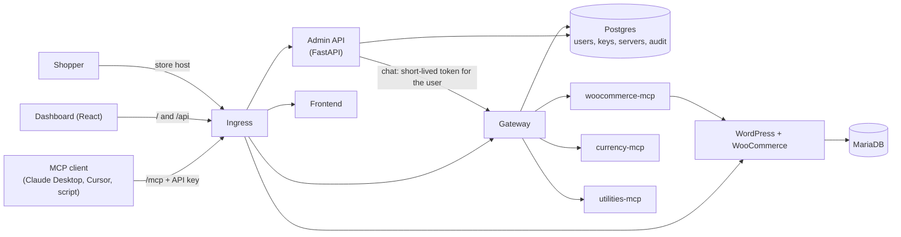

# Urumi MCP Gateway

A team **MCP gateway** that runs on Kubernetes. It puts several MCP servers (a custom WooCommerce
server, a currency server and a utilities server) behind **one authenticated endpoint**, with
admin and member roles, hashed and revocable API keys, an audit log, a React dashboard and a chat
agent that acts as the person who is signed in.

Built for the Urumi AI FDE internship assignment ("MCP Gateway on Kubernetes").

- Requirement-by-requirement status with evidence: [`docs/REQUIREMENTS_CHECKLIST.md`](docs/REQUIREMENTS_CHECKLIST.md)
- System design and tradeoffs: [`docs/DESIGN.md`](docs/DESIGN.md)
- Threat model: [`docs/THREAT_MODEL.md`](docs/THREAT_MODEL.md) (what the gateway does today: [`docs/SECURITY.md`](docs/SECURITY.md))

## Architecture



Public: the dashboard, `/api`, `/mcp` and the storefront, all through the Ingress.
Internal only (`ClusterIP` services plus NetworkPolicies): the three MCP servers, Postgres and MariaDB.
The WooCommerce MCP server can only be reached by the gateway and the admin API.

| Component | What it does | Code |
|---|---|---|
| Gateway | One Streamable HTTP endpoint at `/mcp`. Checks the API key, lists and routes tools, namespaces them, applies timeouts, writes the audit log | `gateway/` |
| Admin API | Login, users, keys, servers, tool catalog, audit log and the chat agent | `admin_api/` |
| Dashboard | React app: servers, tools, chat, keys, audit log | `frontend/` |
| WooCommerce MCP server | Five tools for products and orders | `servers/woocommerce/` |
| Currency and utilities servers | Two small extra upstreams | `servers/currency/`, `servers/utilities/` |
| Helm chart | Everything on Kubernetes | `deploy/helm/urumi/` |

## Run it locally (Windows, kind)

You need Docker Desktop (with at least 5 GB of memory given to it), `kubectl`, `helm` and `kind`.
`*.localtest.me` names point to your own computer through public DNS, so you need internet access
but no edits to the hosts file. Run everything from the project folder in PowerShell.

1. Create the cluster (port 8088 on your computer maps to the cluster's port 80):
   ```powershell
   kind create cluster --name urumi --config deploy/kind-config.yaml
   ```
2. Install the ingress controller and wait for it:
   ```powershell
   kubectl apply -f https://raw.githubusercontent.com/kubernetes/ingress-nginx/controller-v1.12.1/deploy/static/provider/kind/deploy.yaml
   kubectl wait --namespace ingress-nginx --for=condition=ready pod --selector=app.kubernetes.io/component=controller --timeout=180s
   ```
3. Build the two images and load them into the cluster:
   ```powershell
   docker build -t urumi-backend:local .
   docker build -t urumi-frontend:local frontend
   kind load docker-image urumi-backend:local --name urumi
   kind load docker-image urumi-frontend:local --name urumi
   ```
4. Install with Helm (the first install takes several minutes):
   ```powershell
   helm install urumi deploy/helm/urumi -n urumi --create-namespace -f deploy/helm/urumi/values-local.yaml --wait --timeout 10m
   ```
   On a slow laptop this can report a timeout while the store is still being set up. Check
   `kubectl get pods -n urumi`; when every pod is `Running` and the `bootstrap` and `store-setup`
   jobs are `Completed`, it worked. Do not run `helm install` again; use `helm upgrade`.
5. Get the first admin and member keys. They are printed once and never stored in readable form:
   ```powershell
   kubectl logs job/bootstrap -n urumi
   ```
   Copy them somewhere private. Never commit them.
6. Open the dashboard at **http://urumi.localtest.me:8088** and sign in with the admin key.

The development passwords in `values.yaml` are throw-away defaults for a laptop. Never reuse them.

### Turn on the chat agent

The chat agent needs an AI provider key. Any OpenAI-compatible provider works. The default is a free
Google AI Studio key with the Gemini model set in `values.yaml` (`llm.baseUrl`, `llm.model`). Pass the key at
install or upgrade time so it lives only in a Kubernetes Secret:

```powershell
helm upgrade urumi deploy/helm/urumi -n urumi -f deploy/helm/urumi/values-local.yaml --set secrets.llmApiKey=<your key>
```

Note that `helm upgrade` without `--reuse-values` resets values you do not pass again, so pass the key every time.
The admin API restarts by itself when the Secret changes (a checksum annotation on its pod template).

## Place an order (cash on delivery)

1. Open the store at **http://store.localtest.me:8088**.
2. Click **Shop**, add a product to the cart, open the cart and go to checkout.
3. Fill in a test name and address, choose **Cash on delivery** and click **Place order**.
4. You get an "Order received" page with an order number. In the dashboard chat ask
   *"What orders came in today?"* and the order appears.

The store is created by a Helm hook job: WordPress, WooCommerce, cash on delivery, flat-rate shipping,
three sample products and the REST key the MCP server uses.

## Use the chat agent

Open **Chat** in the dashboard and ask something like *"List the products in the store"* or
*"What exchange rates do you have?"*. Every tool the assistant calls is shown under its answer with the time it took.
The assistant uses the same tools the signed-in person can use, as that person: a member's chat cannot
change an order, an admin's chat can. Chat is limited to 20 messages per person per ten minutes so a free AI key is not used up.

## Connect an external MCP client

The gateway is a normal MCP server over Streamable HTTP.

- URL: `http://urumi.localtest.me:8088/mcp` (locally) or `https://<your host>/mcp` (VPS)
- Header: `Authorization: Bearer urumi_...` (any active API key; create your own under **Keys**)

A small client that does exactly this is included. It lists the tools your key can use, calls a safe one, then tries
an admin-only one:

```powershell
python scripts/mcp_client_demo.py
```

It asks for your key with hidden input (or reads the `GATEWAY_KEY` environment variable). With a member key it
lists 8 tools and the admin-only call is refused by the gateway with "You do not have permission to use this tool."
Other clients (MCP Inspector, Claude Desktop, Cursor and similar) need the same two things, the URL and the header;
how a header is entered differs per client, so check that client's documentation for remote HTTP servers.
I tested this with the script above and with MCP Inspector during development.

## Upgrade and roll back with Helm

```powershell
helm upgrade urumi deploy/helm/urumi -n urumi -f deploy/helm/urumi/values-local.yaml --set secrets.llmApiKey=<your key>
helm history urumi -n urumi
helm rollback urumi <revision> -n urumi
```

- Every upgrade is a numbered revision. `helm rollback` returns the chart (images, settings, Secret) to an earlier revision.
- Data is on persistent volumes, so a rollback does not touch the store, the users or the audit log.
- The `bootstrap` and `store-setup` jobs are post-install hooks. They run on install only, not on upgrade or rollback.
- Rolling back after a database change needs care: this project has one schema, applied by the bootstrap job, so there are no
  down-migrations to run.

## Production-like setup on a VPS (k3s)

> Status: this section is written from the chart and the local run. I have not yet deployed it on a VPS, so treat it as a
> tested-in-parts plan, not as proven steps. The local run proves the chart; what the VPS adds is DNS, TLS and a different
> ingress controller.

What changes between local and VPS is only `values-prod.yaml` plus the secrets you pass:

| | Local (kind) | VPS (k3s) |
|---|---|---|
| Ingress controller | ingress-nginx | Traefik (comes with k3s), `className: traefik` |
| Host names | `urumi.localtest.me:8088`, `store.localtest.me:8088` | your own domain, `https` |
| TLS | none | a Secret named by `ingress.tlsSecret` |
| Storage | 1 to 2 Gi, default class | larger sizes, the k3s `local-path` class (set `storage.storageClass` to use another) |
| Secrets | throw-away defaults | your own values from `--set` or an `existingSecret` |
| NetworkPolicy namespace | `ingress-nginx` | `kube-system` (where Traefik runs) |

1. Install k3s on the server: `curl -sfL https://get.k3s.io | sh -`. k3s enforces NetworkPolicies itself.
2. Point two DNS `A` records (for example `urumi.example.com` and `store.example.com`) at the server's public IP.
3. Get a TLS certificate into a Secret named `urumi-tls` for both host names (for example with cert-manager and Let's Encrypt).
4. Get the images onto the server (build them there, then `docker save urumi-backend:local | sudo k3s ctr images import -`, and the same for the frontend), or push them to a registry and set `images.backend` and `images.frontend`.
5. Edit the host names in `deploy/helm/urumi/values-prod.yaml`, then install with your own secrets:
   ```bash
   helm install urumi deploy/helm/urumi -n urumi --create-namespace -f deploy/helm/urumi/values-prod.yaml \
     --set secrets.postgresPassword="$(openssl rand -hex 24)" \
     --set secrets.adminSessionSecret="$(openssl rand -hex 32)" \
     --set secrets.chatGatewaySecret="$(openssl rand -hex 32)" \
     --set secrets.dbPassword="$(openssl rand -hex 24)" \
     --set secrets.dbRootPassword="$(openssl rand -hex 24)" \
     --set secrets.wpAdminPassword="$(openssl rand -hex 16)" \
     --set secrets.wooConsumerKey="ck_$(openssl rand -hex 20)" \
     --set secrets.wooConsumerSecret="cs_$(openssl rand -hex 20)" \
     --set secrets.llmApiKey="<your AI key>" \
     --set bootstrap.adminEmail=you@example.com
   ```
   To keep secrets out of shell history, create the Secret yourself and name it in `existingSecret`.
6. Read the first keys with `kubectl logs job/bootstrap -n urumi` and sign in at `https://urumi.example.com`.

## Run the tests

```powershell
pip install -r requirements.txt
pytest -q
```

97 tests. They use fake replies, so they need no database, store or cluster. GitHub Actions runs them, and
builds the dashboard, on every push (`.github/workflows/tests.yml`).

## Run without Kubernetes (development)

`store/` has a Docker Compose file for a local WordPress and WooCommerce store, `db/` has one for Postgres,
and `scripts/start_servers.ps1` starts the MCP servers. Copy `.env.example` to `.env` (never commit it), then run
the gateway with `python -m gateway.server`, the admin API with `python -m admin_api.app`, and the dashboard with
`npm run dev` in `frontend/`.

## Bonus and stand-out items

| Item | Where to find it |
|---|---|
| Per-tool permissions (admin-only write tools), enforced twice: hidden from members and refused by the gateway | `gateway/permissions.py`, `tests/test_permissions.py` |
| SSRF check when an admin adds or edits a server | `gateway/urlcheck.py`, `tests/test_urlcheck.py` |
| DNS-rebinding protection on the MCP endpoint | `gateway/server.py`, `tests/test_transport_security.py` |
| Kubernetes NetworkPolicies (default deny, tested with a blocked pod) | `deploy/helm/urumi/templates/networkpolicy.yaml` |
| Non-root containers, read-only root filesystem, no service-account token | `deploy/helm/urumi/templates/_helpers.tpl`, `rbac.yaml` |
| Short-lived delegation tokens so the chat acts as the signed-in user | `gateway/delegation.py` |
| Per-person chat rate limit | `admin_api/limits.py` |
| Server health with response time and a 15-second check, plus the audit log with outcome and duration | dashboard **Servers** and **Audit log** |
| Helm upgrade and rollback (documented above; Secret changes roll the pods) | this README, `backend.yaml` |
| Continuous integration | `.github/workflows/tests.yml` |

Not built: multiple gateway replicas with shared sessions, Prometheus metrics, encrypted upstream credentials
(see the threat model), multi-store provisioning.

## Design decisions

- **OAuth 1.0a for the store over plain HTTP.** WooCommerce refuses Basic auth over HTTP, so the client signs each request. On HTTPS Basic auth can be used.
- **Clear errors for the AI.** Tools raise `ToolError` with a short readable message; other exceptions would be hidden by the SDK.
- **Privacy by design.** Order tools return the customer name only, never emails or addresses. The audit log never stores tool arguments.
- **Input validation on the server.** Bad prices, stock values and order statuses are rejected before reaching the store.
- **No credentials in logs.** The HTTP library's request log printed signed URLs, so that logger is silenced.
- **Separation of concerns.** The store client and the MCP tools live in separate files, and the gateway, admin API and servers are separate processes.

More in [`docs/DESIGN.md`](docs/DESIGN.md).

## How this was built

I built this project with Claude (Anthropic) as an AI pair programmer, and I am open about that. I decided what to build and worked
through it step by step: I ran every command myself, set up Docker, the store, the cluster and Helm, tested each tool, diagnosed the
problems that came up (a free AI key hitting rate limits, a cluster starved of memory, a host-name check rejecting in-cluster
calls, and others), tested the behaviour on the real cluster, and committed and pushed each step. Claude helped write and explain the
code. I am responsible for the project and can walk through how each part works. The commit history shows the AI help with
`Co-Authored-By: Claude` lines.
